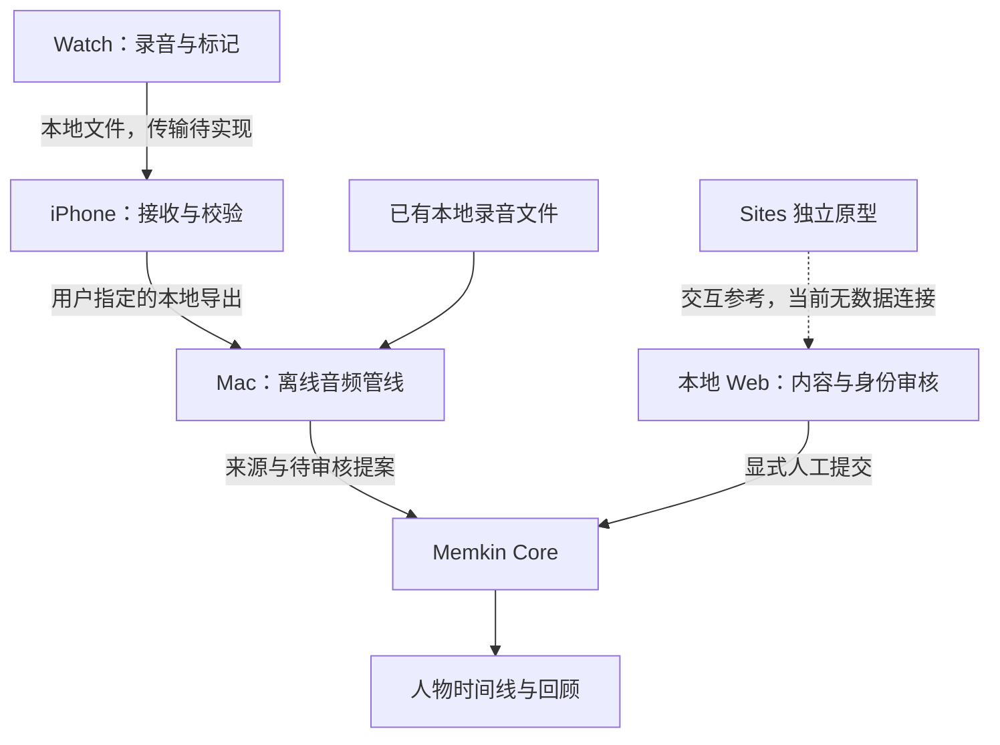

# MemKin Voice：跨端语音记忆与人物关系 SPEC

- 文档版本：0.1 / RFC，2026-11-10（Asia/Shanghai）。
- 范围：产品目标、Watch / iPhone / Mac / Web 的职责、P0 数据契约、人工审核、当前网站、集成缺口、协作与验收。
- 状态：**供跨会话评审的候选基线，尚未宣称所有端已对齐或已实现。** 用户明确要求的隐私与人工确认约束始终生效；新增实现方案须在后续 PR 中验收。
- Core 基线：`195d5398dece493e0eb65181994f2f44ce5e6ee4`（main）。
- Voice P0 基线：`c458aedf33b5971bd948f714f11fb6f91fb8a9ae`（`feat/memkin-voice-p0`，[PR #141](https://github.com/AndreLYL/memkin/pull/141)，本次核对时尚未合并）。
- Sites 网站基线：`0c110f7f7b9f7e294e9342cf14588c0b4a8ca40b`，独立 Sites 源码仓库；**不是本仓库的提交**。
- 原型入口：<https://memkin-voice-lyl.lylandre2017.chatgpt.site/>，仅所有者登录访问；访问权限不等于数据同步。

配套文件：[当前实现与差异矩阵](IMPLEMENTATION-MATRIX.md)、[Mac 开发交接与协作规则](MAC-HANDOFF.md)、[合成转写样例](fixtures/transcript.synthetic.json)。

## 1. 要解决的问题

用户希望把生活中的语音对话逐步整理为可追溯的个人记忆：记住发生了什么、谁参与或被提及、哪些事实已核实、关系如何变化，以及接下来要做什么。系统需要保留原始声音与原文，允许回顾、修订和纠错，避免将转写错误、推测、计划或错认的人物沉淀为既成事实。

核心流程是：录音采集/导入 → 本地离线转写 → 摘要与候选信息 → 事实确认 → 人物身份确认 → 关系记录 → 回顾与行动。界面可以分步操作，但正式提交必须同时满足内容确认、身份确认和证据有效三个条件。

这是一个聚焦语音到人物记忆的小产品。P0 复用已有 Memkin CRM，不重新开发整套知识库、通用 Agent 平台或第二套人物数据库。

### 1.1 必须持续满足的约束

| ID | 约束 |
| --- | --- |
| INV-01 | 私人录音、转写、声纹和数据库不上传到 Sites 服务端、GitHub、云端模型或第三方分析服务。Git 中只保留代码、设计与明确虚构的样例。 |
| INV-02 | 转写与模型输出只是证据/提案，未经人工确认不进入正式人物事实、关系或长期记忆检索视图。保存本地原件不等于确认其中内容。 |
| INV-03 | 姓名、昵称、拼音或声纹相似度都不能自动合并人物。未知身份保留未知，用户明确选择稳定人物 ID 或创建独立人物。 |
| INV-04 | 原始音频、已入库转写及来源时间不可静默覆盖；编辑的是整理稿、提案或新修订。 |
| INV-05 | 采集时间、入库时间、事件发生时间、事实有效时间分别保存。未知或部分日期不能编造精确值；计划不能变成已发生事件。 |
| INV-06 | 不替用户联系任何人；待办只记录行动，不自动发消息、邀请或通知联系人。 |
| INV-07 | 重试不重复建档；并发修改不以最后一次写入静默覆盖。失败需可见，并保留恢复依据。 |
| INV-08 | 读取配置错误、离线模型缺失或本地服务不可用时停止相应步骤，不回退到云端、正式默认数据库或假提案。 |

## 2. 证据、设计来源和可信范围

文档使用三种标签：**已核对代码**、**用户约束/目标**、**设计提案**。历史助手建议不自动升级为已实现能力。

| 来源 | 可确认的信息 | 限制 |
| --- | --- | --- |
| 2026-10-25 的既往讨论检索摘要 | 用户希望记录对话、保留原文、辨别说话人，并形成跨会话人物记忆；此前建议复用 Core、独立音频管线 | 来自检索摘要，不是 Mac 当前工作区检查；模型和端间传输建议尚不能当作已完成 |
| 2026-11-10 网站创建请求及本会话 | 中文工作台、筛选、原文对照、人工确认、人物卡片、关系变化、周回顾；禁止私人数据上传 | 这是本次产品约束来源 |
| 本会话网站源码与构建记录 | 浏览器本地原型实际行为，详见差异矩阵 | 不证明 Watch/iPhone 实现或 Core 互通 |
| Core main 的 CRM 代码与文档 | 稳定人物 ID、不可变来源、proposal/apply、revision、REST/MCP | 固定提交的代码核对；本次未重新执行整个 Core 测试集 |
| PR #141 的代码、文档和 PR 描述 | 本地 Voice CLI、hash-bound transcript、显式本地模型、人工 review 文件 | 未合并；PR 的历史验证结果是作者报告，不是本 SPEC 新做的运行验证 |
| 用户说明 Mac mini 正在开发手机/手表 App | 确认存在并行开发活动 | 本会话未访问 Mac 本地路径、未提交修改、Xcode 工程和真实设备，不能推断进度 |

实现依据：

- [Core CRM 合同](https://github.com/AndreLYL/memkin/blob/195d5398dece493e0eb65181994f2f44ce5e6ee4/docs/person-crm.md)。
- [Core schemas](https://github.com/AndreLYL/memkin/blob/195d5398dece493e0eb65181994f2f44ce5e6ee4/src/crm/schemas.ts)、[store](https://github.com/AndreLYL/memkin/blob/195d5398dece493e0eb65181994f2f44ce5e6ee4/src/crm/store.ts)、[REST routes](https://github.com/AndreLYL/memkin/blob/195d5398dece493e0eb65181994f2f44ce5e6ee4/src/server/crm-routes.ts)。
- [Voice P0 使用说明](https://github.com/AndreLYL/memkin/blob/c458aedf33b5971bd948f714f11fb6f91fb8a9ae/docs/memkin-voice-p0.md)、[Mac 准备](https://github.com/AndreLYL/memkin/blob/c458aedf33b5971bd948f714f11fb6f91fb8a9ae/docs/memkin-voice-mac-setup.md)。
- [Voice transcript 合同](https://github.com/AndreLYL/memkin/blob/c458aedf33b5971bd948f714f11fb6f91fb8a9ae/src/voice/transcript.ts)、[pipeline](https://github.com/AndreLYL/memkin/blob/c458aedf33b5971bd948f714f11fb6f91fb8a9ae/src/voice/pipeline.ts)、[CLI](https://github.com/AndreLYL/memkin/blob/c458aedf33b5971bd948f714f11fb6f91fb8a9ae/src/voice/cli.ts)、[本地 providers](https://github.com/AndreLYL/memkin/blob/c458aedf33b5971bd948f714f11fb6f91fb8a9ae/src/voice/providers.ts)。

## 3. 产品范围与阶段

### 3.1 P0：先验证一条可信记忆的完整闭环

P0 使用用户手动选定的本地音频，不依赖自研 Watch App 完成才开始测试。已有 Voice 分支的流程为：

1. 用户取得一个实际本地音频文件，提供原始录制时间和 IANA 时区。
2. `voice import` 归档原始字节，校验 hash；运行已下载的离线 ASR，或导入与音频 hash 绑定的结构化转写。
3. 保留转写与分段时间戳，将长录音分成多条本地 CRM source。
4. `voice propose` 使用显式本地 Ollama 或人工 JSON，生成带逐字证据的待审核提案。
5. 用户检查所有将被应用的内容，为所有临时人物引用确认身份，提交 `review.json`。
6. `voice apply --review` 将已审核 proposal 写入 CRM 人物记忆，后续在现有本地 UI/MCP 中查看。

上述 CLI 文件流程在 PR #141 有实现。网站原型另行存在，**目前不能替代第 4～6 步的真实 Core 审核入口**。

### 3.2 P0 后续集成目标（待实现）

- 将网站中有价值的交互迁入/适配到本地 Core Web UI，用 Core 人物 ID、Voice session 和真实 proposal 驱动页面。
- 先支持本地文件导入和审核文件导出；再设计单进程本地服务接口，避免多进程同时打开 PGlite。
- iPhone/Watch 可以独立开发录音探针，但其完成度不阻塞后端文件流程；采集文件须能被同一导入合同接收。
- 支持按条审核的后端语义、隐私标签持久化、任务模型、审核元数据及撤回协议，必须通过明确扩展实现，不能仅改界面文案。

### 3.3 后续研究，不作为 P0 已交付

全天候长时录音、自动说话人分离、声纹注册和跨会话匹配、自动跨设备同步、定时后台回顾、原生跨端双向编辑、加密同步。全天录音是探索方向，不能承诺 24 小时后台存活或续航；真机结果决定是否推进。

## 4. 各端职责与数据权威

| 端/组件 | 目标职责 | 正式数据权威 | 当前核对情况 |
| --- | --- | --- | --- |
| Watch | 主动录音、停止/标记、保存片段、待传输队列、可见失败状态 | 原始采集片段及其元数据的产生端 | 用户报告正在开发；GitHub 被核对的 Voice 分支没有原生工程 |
| iPhone | 接收并核验片段、传输队列、携带状态、轻量确认与查阅 | 原件的本地副本；身份和正式事实仍用 Core ID | 本会话未核对 Mac 工作区实现 |
| Mac 本地 Audio Pipeline | 原件归档、离线 ASR、分段、证据定位、状态恢复 | Voice session / transcript / archive manifest | PR #141 有 CLI 版本 |
| Memkin Core | 来源、人物身份、提案、正式条目、历史修订与派生检索 | 结构化 CRM 为正式记忆唯一权威；派生页面不另立主库 | main 有 Person CRM |
| 集成后的本地 Web UI | 原文对照、内容与身份审核、关系时间线、回顾与行动 | 通过 Core 操作，不再拥有独立正式人物/事实 ID 空间 | 设计目标，尚未连接网站原型 |
| 当前 Sites 原型 | 展示和试验完整交互；使用浏览器内样例/用户手动导入的本机文件 | 仅为此浏览器的独立草稿/演示状态 | 已实现；无跨端同步，无 Core 连接 |

设计提案中的目标拓扑：



### 4.1 本地优先的连接方式

当前默认采用文件模式。用户从本机导入文件、下载结果；网站服务端不代理任何私人内容。本地页面和外网托管页面不是同一数据源。

候选集成路线是把 UI 放到 Mac 本地 Core 服务中，由同一进程承接 Voice/CRM；若保留 hosted UI，不得默认让其调用本地端口。鉴权、Origin/CORS、HTTPS 与 loopback 访问、令牌保存、数据流向都需单独设计和评审。Sites 的登录凭证不是 Memkin bearer token。不能把“用户打开了网站”视为授权访问本地文件或数据库。

在保持当前文件模式的 P0 中，没有跨设备并发写正式记忆的问题。未来手机审核若开启，所有正式写入须经同一个 Core 服务；不得让手机、网站和 CLI 分别直接改同一个 PGlite 目录。

## 5. 用户体验与页面合同

视觉方向采用克制的暖白、鼠尾草绿和深绿；重点突出信息层级与当前确认状态。波形装饰不能冒充真实音频波形、ASR 进度或处理结果。手机 Web 采用窄屏导航和堆叠布局；这不代表存在原生 iOS App。

### 5.1 页面

| 页面 | 内容与动作 | 限制 |
| --- | --- | --- |
| 概览 | 最近录音、待确认计数、人物、事实、待办、流程入口 | 统计必须标明来自演示、本机草稿还是 Core；不能混计 |
| 语音记录 | 搜索标题/原文/人物；组合日期、人物、事件类型、状态、隐私筛选 | 日期轴必须可解释；分页后不能只筛当前页并伪称全量结果 |
| 记录详情 | 音频/来源、四个工作区：事实确认、原文对照、人物与行动、审核日志 | 音频缺失可继续文字审核；无时间定位时显示不可定位 |
| 人物关系 | 姓名/称呼/别名、与我的关系、长期背景、近期事件、待核实信息、变化时间线 | 身份 ID 与姓名分离；被提及不等于参与 |
| 周度回顾 | 日期范围、已确认事实/人物变化、待核实数量、行动清单、来源跳转 | 不把待核实内容写成肯定句；计划保持计划 |
| 待办清单 | 关联来源、可选日期、完成/重开、导出 | 不自动联系任何人；没有确定日期时不编造截止时间 |
| 本地与隐私 | 存储位置、模型/网络模式、备份、导入合同、清理范围 | 当前浏览器 JSON 备份不含音频，也不是 Core 完整数据库备份 |

### 5.2 每条记录的最小展示字段

原始录制时间及其精度/时区、导入时间、事件类型、参与/提及的人物、原始转写、可编辑整理稿、已确认事实、待确认内容、证据来源、隐私级别、后续行动、管线状态、最后错误、审核及正式写入状态。日期未知时允许缺失，但不得用导入当天伪装为录音日期。

### 5.3 一次人工审核

1. 查看原始发言及完整上下文，需要时定位音频区间。
2. 核对候选事实的内容、时间、涉及人物和证据；修订候选不会改原文。
3. 明确说话人身份和“实际参与/仅被提及”，未知身份可以先留空，但涉及未知身份的正式提交要阻断。
4. 标注审核状态；摘要、人物背景和关系变化也不能绕过审核。
5. 展示本次正式提交的确切条目和人物映射；确认人、来源版本、审核时间与操作结果可追踪。
6. 只有 Core 的成功响应及返回 IDs 才代表正式写入；网络中断后先查询状态再重试。单纯下载 JSON 不算写入。

无须模型也应能手动完成整理。按句拆分只是一种输入辅助，不具备事实判断、因果分析或可靠人物识别能力。

## 6. 状态设计：分清管线、审核、写入和事实语义

### 6.1 已有 Voice 管线状态

已有 `VoiceSession.state` 仅为 `saved → transcribed → captured → proposed → applied`。`saved` 表示原件归档，`captured` 表示 CRM 来源保存，不代表事实得到确认。错误保存在 `last_error`，不新增伪造的后端枚举。长会话中 `records[].applied` 可先部分为 true，最终全部完成后才将 session 设为 applied。

### 6.2 界面审核状态（候选 UI 合同）

| 显示 | 候选内部名 | 含义 | 可写正式记忆 |
| --- | --- | --- | --- |
| 仅来自转写 | `transcript_only` | 刚从文字获得，尚未人工判断 | 否 |
| 待确认 | `pending` | 已开始核对，仍有身份/内容/时间问题 | 否 |
| 已确认 | `confirmed` | 用户核实了当前版本的表述及身份 | 还需显式提交、证据校验和 Core 成功响应 |
| 不应写入长期记忆 | `excluded` | 不应保存为正式事实，或只保留原文上下文 | 否 |

这些英文名是 UI/侧车的设计提案，**不是现有 CRM EntrySchema 接受的新字段**。当前 Sites 直接存储上述中文字符串。

### 6.3 写入状态（设计提案）

`not_submitted / submitting / applied / failed / needs_review` 分别表示未提交、提交中、收到成功结果、失败和源版本/人物 revision 改变需重审。部分成功按 record/proposal 显示。撤回正式条目没有已验证 API，不得显示“Core 已撤回”除非实际协议已实现。

### 6.4 事实本身的时间/语义状态

Core fact/relationship 的 `current / past / planned / uncertain`，以及 interaction 的 `happened / planned / cancelled`，描述现实语义，**不是人工审核状态**。“已确认对方表达了搬家计划”可以仍然是 `planned`，不能写成已经搬家。`uncertain` 也不是用户批准写入的替代标志。P0 默认不把未核实事实应用进正式记忆。

## 7. 复用现有合同，禁止建立第二套正式协议

### 7.1 身份与 ID

| 标识 | 已有格式/作用 |
| --- | --- |
| Voice session `id` | 32 位小写十六进制；由音频 hash、原始时间字符串和时区计算 |
| `audio_sha256` / `transcript_sha256` | 64 位小写十六进制，前者绑定音频字节，后者校验落盘转写 |
| segment `id` | `s` 加 6 位数字，如 `s000001`；同一 transcript 内唯一 |
| speaker label | 当前 session 内的标签或 null；不是 person_id |
| CRM record/proposal/entry IDs | Core 产生的字符串 IDs；不得由网站本地 r1/p1 代替 |
| CRM person_id | 正整数，稳定身份；已有 profile revision 用 `expected_revision` 校验 |
| proposal person key | 临时引用，如 p1，仅在提案中有效，apply 时显式解析为已有/新人物 |
| 来源 `external_id` | 当前 Voice 实现为 `memkin-voice:<session-id>:v1:<part-index>`，part 从 0 开始 |

相同音频、相同原始时间和时区的改名文件应重用 session。改变时间表示或时区按当前实现会产生不同 session，界面需告知，不得当作无损元数据编辑。

### 7.2 Transcript v1：以现有代码为准

正式输入使用 PR #141 的 `TranscriptSchema`：

```json
{
  "schema_version": 1,
  "audio_sha256": "aaaaaaaaaaaaaaaaaaaaaaaaaaaaaaaaaaaaaaaaaaaaaaaaaaaaaaaaaaaaaaaa",
  "duration_ms": 10000,
  "language": "zh",
  "asr": {"provider": "synthetic-fixture", "model": "none"},
  "diarization": "none",
  "segments": [
    {"id": "s000001", "start_ms": 0, "end_ms": 5000, "speaker": null, "text": "这是完全虚构的测试发言。"}
  ]
}
```

上述 hash 仅示意，不是可导入某个真实音频的 hash。配套 fixture 采用同样的纯合成规则。

约束：时长正整数；起止时间为毫秒整数，`0 <= start_ms < end_ms <= duration_ms`；按 start_ms 非递减排列（不假设对话绝无重叠）；segment ID 不重复；每段 text 非空且最多 10000 字符；`diarization=none` 时 speaker 必须为 null。当前 schema 允许 `none / manual / pyannote`，允许枚举不代表已实现 pyannote 处理器。faster-whisper 默认输出 none/null。

`captured_at`、timezone 和 session 元数据来自 `session.json` / 导入参数；不要把它们擅自塞进 strict TranscriptSchema。完整时间戳必须包含 UTC offset；仅有日期的原型记录需由用户补全或作为有损草稿保留，不能自动补成当日零点。

### 7.3 VoiceSession / 归档

已实现的 session 包括 `schema_version, id, audio_sha256, audio_file, source_name, captured_at, timezone, created_at, state, transcript_sha256?, last_error?, records[]`。records 包括 `id, part, proposal_id?, applied?, evidence?: [{quote, segment_ids}]`。

归档保存原始音频、session.json、transcript.json、可读 transcript.txt、proposals.json、review-template.json、summary.txt。UI 增加的标题、事件类型、隐私标签、审核操作员与待办目前没有共同持久化合同；先作为独立侧车提案评审，不能写回现有不可变来源字段或假装 Core 已支持。

### 7.4 Source / Proposal / Apply

来源创建沿用 CaptureSchema：`content, source="voice", captured_at, timezone, external_id?, person_ids`。Core 的严格对象会拒绝未定义字段。

Proposal 沿用 `people[]` 与 `entries[]`：条目为 `interaction / fact / relationship`，且 `evidence.quote` 必须逐字包含在保存的 source 中。提取结果中的人物名字只是引用；profile_patch 需要独立证据与用户确认。

Voice review 文件沿用：

```json
{
  "session_id": "00000000000000000000000000000000",
  "records": [{
    "record_id": "REPLACE_WITH_RETURNED_RECORD_ID",
    "proposal_id": "REPLACE_WITH_RETURNED_PROPOSAL_ID",
    "identities": {"p1": {"person_id": 42, "expected_revision": 1}}
  }]
}
```

此处所有 ID 都是占位符，不能直接用于真实写入。新人物必须经明确选择，使用 `{ "new_person": { "name": "合成测试人物甲" } }`。同一人跨 part 使用同一稳定人物 ID，避免每段重复新建。

**关键限制：**现有 ApplySchema 只有 identities，应用的是整个 proposal，没有“只应用这些 entry IDs”的参数；VoicePipeline.apply 要求 review 覆盖 session 中全部已保存 record/proposal。界面逐条确认不意味着 CLI 已支持部分选择。存在 pending/excluded 条目时，P0 集成必须阻止整份 apply，不能为了让流程成功而把未确认内容一起提交。选择性提交/替换提案版本属于后续扩展，需要同时更新 pipeline、manifest 关联及幂等验收。

## 8. 转写、摘要、身份与证据规则

### 8.1 离线音频管线

- 模型和依赖的下载属于单独准备阶段；处理私人文件时只使用已下载模型。
- 当前实现为独立 Python faster-whisper worker，Mac 首轮 CPU/int8；不宣称已有 Metal 加速。
- 本地 Ollama 是可选提案生成器，禁用云端模型和远端 URL；默认 CRM `/extract` 可能受通用 provider 配置影响，不能作为 Voice 的安全替代入口。
- 模型不可用时保留原件/文字稿；允许人工 proposal，不能生成假成功。
- 摘要是可编辑视图，不是额外可信来源。当前 Voice summary.txt 是提案的可读导出；网站的自动整理仅是最多 16 句的本地拆分和前两句摘要。

### 8.2 原文对照与回听

原文只读，整理稿另存。证据必须能从 entry → proposal → CRM record → session part → segment IDs → audio hash 定位。反复出现的短句须保留全部候选位置，不能悄悄选择第一次。

集成 UI 有毫秒起止区间时才允许定位回听；用户选择一个候选区间后播放。文本拆句的索引不是可靠 segment 对齐，不能用它伪造精确时间戳。单纯有浏览器 audio controls 只代表可播放本地文件，不代表具有证据定位能力。

### 8.3 说话人识别与声纹

P0 可以给单次 session 的 speaker label 做人工映射。映射到人物不自动认定每一条事实的主语：发言者可能在谈第三人。参与人、被提及人和事实主体分别审核。

声纹注册和匹配为后续提案：注册样本必须明确属于指定 person_id；模型版本、样本来源和匹配置信度单独保存。匹配只给候选，不触发人物合并或正式写入。不得把姓名转写纠错自动写成某人的“别名”。

## 9. 人物卡片和关系时间线

集成后复用 CRM profile（name/aliases/contacts/notes 等）和结构化 entries。姓名是展示属性，姓名修订不改变 person_id。与用户的关系应关联明确的“本人”实体；本人身份尚未配置时不能靠创建同名测试人物自动补全。

每条关系变化需说明主语、对象、关系、语义状态、有效起止、来源及确认过程。已发生事件、未来计划、暂未核实的信息分开展示；不得从联系频率、语气或缺少互动自动推断关系疏远/冲突。

长期背景应来自已审核条目或明确标注的人工维护文本；待核实字段不进入正式事实检索。用户手动输入没有录音证据的背景/关系事件时，可以先保存为草稿；若要正式提交，创建有时间和来源的 manual source，再按 CRM 审核路径应用。网站原型中“人工维护”标签本身不是 Core 审核证据。

## 10. 周度回顾与待办

默认按用户选定时区的采集时间范围回顾，明确可切换事件发生时间轴。查询边界应转换为绝对时间；Core 日期筛选与部分日期规则沿用现有 temporal 合同。未知事件日期不混入有界事件时间查询。

- 回顾分为已确认事实、已确认的计划/变化、需要核实的数量或单独列表、后续行动。
- 已确认事实每条带 source/entry IDs、日期和可用的证据定位；不重写成未经审核的新结论。
- 当前网站按“已确认”状态展示，包括已确认但尚未点击本机写入的事实。正式集成默认使用 Core 已应用条目；若展示未提交草稿，必须独立标明。
- 行动是计划，不表示事件已完成；日期可空，完成和重开保留来源。
- Core 现有 CRM schemas 不含网站 actions[]；任务持久化/与既有通用任务系统的映射需后续决定。
- P0 回顾是用户点击触发的本地操作，不新增自动任务、后台通知或联系人消息。

## 11. 当前网站的数据边界与迁移策略

网站原型是独立 React/Vinext 页面。正文/人物/审核数据使用当前 origin 的 `localStorage["memkin-voice-v1"]`；音频使用 IndexedDB `memkin-audio-v1` 的 `audio` object store，按本地 record ID 取文件。没有使用 D1/R2 保存私人数据，没有业务 fetch/API 调用，也没有 Core bearer token。

浏览器隔离意味着电脑、手机、内嵌浏览器、预览域名和发布域名可能各有一份独立状态。浏览器清理/配额限制可能丢失记录；本机存储未做应用层加密。网站页面本身需网络加载，目前无已验收的离线应用缓存机制。

原型“确认写入长期记忆”只把 fact ID 加入记录的 memory[]，**不是 Core 成功写入凭据**。其导出的 `write_policy: human_confirmed_only` JSON 不是 Core Capture/Proposal/Apply 格式；主仓库和 Voice 分支均没有已验证的该格式导入器。原型备份 `schema: memkin-voice-v1` 也只用于该原型恢复，且不含音频。

迁移时：

1. 保留原型备份，先做只读差异预览，不自动导入正式库。
2. 读取 canonical transcript/session 并保留 hash、segment IDs、时区、完整 captured_at；旧原型缺失的字段必须标明缺失，由用户补全，不能生成假来源。
3. 网站本地人物 ID 逐一映射 Core 正整数 ID；同名不自动合并。
4. 原型 fact.text 需人工/本地提案转换为 Core typed entry，并附逐字 quote；只有时间字符串 at 不足以构成证据。
5. 原型 confirmed / memory[] 作为既往本机操作记录显示，不能直接视为正式 Core 确认。用户在真实 proposal 预览上重新确认内容和身份。
6. 保持原型和集成环境明显区分，不让一次浏览器刷新切换正式数据库；完成迁移后避免两套正式记忆并存。

具体字段冲突见 [IMPLEMENTATION-MATRIX.md](IMPLEMENTATION-MATRIX.md)。

## 12. 现有接口与未来接口边界

以下为 main 已有接口，前缀 `/api/crm`；不是本 PR 新增 API。

| 操作 | 现有 REST | 关键规则 |
| --- | --- | --- |
| 人物读写 | GET/POST `/people`；GET/PUT `/people/:id` | 更新要求 profile、expected_revision、reason |
| 来源捕获/读取 | POST/GET `/records`；GET `/records/:id` | 原始时间、时区、external_id；不修改已保存原文 |
| 提案保存/读取 | POST/GET `/records/:id/proposals` | entries 和 evidence.quote 校验 |
| 通用 AI 提取 | POST `/records/:id/extract` | **Voice P0 不默认调用**，先验证本地专用 provider 边界 |
| 人工应用 | POST `/proposals/:id/apply` | identities；整 proposal；幂等；人物 revision 冲突返回 409 |
| 时间线 | GET `/timeline` | 采集/事件双时间轴、人物、主题、角色、日期范围 |
| 条目修订 | PUT `/entries/:id` | expected_revision、reason；保留 kind 和逐字证据 |
| 修订历史 | GET `/history/:type/:id` | type 为 person 或 entry |

目前没有已核对的 `/api/voice` 音频上传、网站草稿导入、部分 apply、正式记忆撤回、隐私标签过滤或自动设备同步接口。后续 PR 可以设计，但不得在客户端先假定存在。

候选服务化方案须调用同一进程的 VoicePipeline/CrmStore，并保留本地 provider、校验和与锁。不能用新增 HTTP 外壳绕过显式 config、本地 DB 限制和人工 review。

## 13. 错误、重试、并发与撤回

| 场景 | 已有行为/集成要求 |
| --- | --- |
| 模型未下载、ASR 失败 | 原件先归档；last_error 可见；同输入恢复，不替换原件 |
| 转写 hash 与音频不符 | 阻断导入/提交，不猜测属于哪个音频 |
| 已有转写被修改或新转写不同 | 现有 P0 拒绝覆盖；修订转写需未来版本协议 |
| 重复导入、改文件名 | 复用既有 session 与 external ID；相同内容不得生成重复正式记忆 |
| 同 external ID 内容/时间/关联冲突 | Core 返回 CONFLICT；人工核对，不能自动新建以绕过 |
| 人物 revision 过期 | 展示新旧差异，重新确认；禁止强制覆盖 |
| archive 被活跃进程使用 | 不抢锁；显示忙碌；损坏锁按现有文档人工处理 |
| PGlite 被另一个进程打开 | 不绕过锁；停止共享进程或用后续单服务架构 |
| 长会话 apply 中途失败 | 单 proposal 事务，跨 proposals 可部分成功；按 IDs 查询/重试，UI 显示部分成功 |
| 原型事实修订/改为待确认 | 只撤去浏览器 memory[] 标记，不影响任何 Core 数据 |
| Core 已应用条目想撤回 | 当前无已验证撤回接口；明确显示未完成撤回，不可用 UI 状态假装删掉正式记录 |
| 清理/删除 | 原型清理不删除 Mac archive/CRM；Core 有不可变原文策略，完整删除与派生数据失效需独立实现和验收 |

正式接入前必须决定：内容排除/撤回、审核记录的持久化、跨端审批的版本绑定、索引失效，以及删除与不可变证据的边界。未实现前不承诺可以撤销正式写入。

## 14. 原生采集端的验收要求（设计目标）

Watch/iPhone 的具体 API 和当前实现由 Mac 端核对，本 SPEC 不替代实际 Xcode 工程。

- 用户可主动开始/停止并看见录音状态；中断、低电量、空间不足、权限问题需明确反馈。
- 录音采用可恢复片段，保存原始 capture time/时区/设备内 session、chunk 序号、字节 hash；chunk 协议待 Mac 端确认后版本化。
- 未收到接收端持久化及 checksum 确认前，不删除唯一原件；重复传输幂等，重启后恢复队列。
- 手表录音/传输标签不决定 CRM person_id；采集端不得提前把未知发言当作“本人”。
- 本地模式不隐式走 iCloud 或其他同步目录；实际系统语音备忘录设置需用户知情核对。本 SPEC 不修改设备设置。
- 真机验证熄屏、回表盘、切 App、来电/Siri/音频路由变化、手机离开/重连、重启、断网、低存储，以及 1/4/8 小时的完整性和电量变化。
- 编译签名成功、后台可靠性、ASR 质量是不同结论；模拟器或后端测试不能替代配对真机验收。

## 15. 非功能需求

| 项目 | 要求/测量方法 |
| --- | --- |
| 隐私 | 在合成数据下验证私人内容处理路径不访问外部服务；模型下载阶段和处理阶段分别记录。日志不输出原文或令牌 |
| 可恢复性 | 注入 ASR、CRM、proposal、apply 与落盘错误，重试恢复；核对原件 hash 和记录数 |
| 可解释性 | 每个正式条目可追溯原文 quote；有音频证据时保留所有候选 segment IDs |
| 并发安全 | 重放相同输入幂等；陈旧 revision 返回冲突；一个 archive 单 writer |
| 性能 | 报告机器、模型、音频长度、墙钟耗时、峰值内存、实时因子 RTF；不预先承诺实时或精度指标 |
| 易用性 | 中文、键盘可操作、清楚的状态文字、窄屏可用；无数据和失败不是空白页 |
| 备份 | Core DB 与 Voice archive 成套备份；浏览器 JSON 另行标记其范围，不冒充全量备份 |

## 16. 验收场景

下列为跨端集成的**待执行验收清单**，不是本 PR 的测试通过报告。使用虚构内容或用户明确选定且仅在本机处理的样本；Git 中不得提交私人样本。

| ID | 场景 | 通过条件 |
| --- | --- | --- |
| AC-01 | 本地音频导入 | 原件字节 hash 不变；原始录制时间不替换为导入时间 |
| AC-02 | offline 模型缺失 | 明确失败并保留原件；不自动下载/调用云端 |
| AC-03 | transcript 严格校验 | hash 错、重复 ID、非法时间、none 下非 null speaker 均被拒绝 |
| AC-04 | 无 diarization | 展示未知说话人；不会自动关联本人 |
| AC-05 | 重复导入/改名 | session/record 不重复；改变时间上下文需显式警示 |
| AC-06 | 摘要与原文 | 修改整理稿不改原始转写或 hash |
| AC-07 | 原文证据 | 不存在于 source 的 quote 不可保存/应用 |
| AC-08 | 重复短句 | 保留全部候选音频位置，不强行定位第一处 |
| AC-09 | 人物歧义 | 同名不合并，未选择身份不能正式 apply |
| AC-10 | 四类审核状态 | pending/transcript_only/excluded 从正式提交集合排除 |
| AC-11 | P0 整份 apply 限制 | 任何未确认条目阻断整 proposal；不使用不存在的 partial_apply 参数 |
| AC-12 | 确认与幂等 | 重复确认同 proposal 返回原有 IDs，不重复建立人物条目 |
| AC-13 | 并发修订 | expected_revision 过期返回 409 并要求重审 |
| AC-14 | 长会话部分失败 | 已成功 part 可识别，重试不重复；未完成不显示 session 全成功 |
| AC-15 | 原型迁移 | 缺失 hash/时区/人物映射时阻断正式提交；不信任 memory[] 当作已入 Core |
| AC-16 | 原文/计划时间 | “下周考虑搬家”不更新当前地址，不显示已搬家 |
| AC-17 | 组合筛选 | 日期、人物、类型、确认、隐私可组合且重置；采集/事件轴清楚 |
| AC-18 | 人物时间线 | 实际参与与仅被提及分开；修订身份后派生关联同步更新 |
| AC-19 | 周回顾/待办 | 正式回顾只用已应用条目，计划保留语义；待办不触发外部联系 |
| AC-20 | 导出/恢复 | 明确区分原型备份、Core 备份、Voice archive、审核文件；合成 round-trip 保留必要字段 |
| AC-21 | 锁与进程 | 活跃 writer 不被抢占，PGlite 不被多进程强开 |
| AC-22 | 私密边界 | 页面/本地处理不发送音频、转写、DB、声纹到外网；通用云 provider 不被继承 |
| AC-23 | 真机采集 | 中断/离线/重启可恢复；未确认接收前原件不丢失；电量与缺口可测量 |
| AC-24 | 撤回文案 | 未实现 Core 撤回时明确告知，不能仅改前端标记并显示成功 |

## 17. 路线图与任务拆分（提案）

| 优先级 | 工作包 | 交付物 | 依赖 |
| --- | --- | --- | --- |
| 0 | Mac 当前基线登记 | 路径/仓库/branch/commit、原生端状态、未提交范围 | Mac 会话读取自身工作区 |
| 0 | 核对 PR #141 | 本地模型实测、失败恢复与已有测试限制 | 参考现有 P0 文档 |
| 0 | 原型互通适配设计 | canonical transcript/session 导入、人物 ID 映射、真实审核文件预览 | 本 SPEC 评审 |
| 0 | 防误写 | 全 proposal 审核门禁、写入结果与原型状态区分 | Core/Voice contract |
| 1 | 本地 Web 集成 | 复用当前交互，接入 Core 已有 records/people/timeline | 单进程数据通路与鉴权方案 |
| 1 | 审核扩展 | 逐条排除/选择、审核 revision、持久化元数据、撤回语义 | Core 与 pipeline 一起改 |
| 1 | Watch/iPhone 采集探针 | 本地采集/传输合同及真机报告 | Mac 工程核对 |
| 2 | diarization/声纹 | 可替换 provider、人工注册/匹配候选、独立评测 | 已验证录音质量与身份模型 |

不以网站上线代替 P0 后端、模型和原生端验收；也不因原生端尚未完成而停止本地文件闭环验证。

## 18. 跨会话协作与待决策项

两个会话的聊天记忆不能作为唯一协议。共享来源是 Git 中经评审的文档、schema、样例和 commit。每次接口相关开发先读取本目录及对应源码；如果 Mac 工作区已有更新，以核对后的代码修订本文，不能用本 RFC 覆盖其未检查的实现。

- 公共合同变更先更新 SPEC/样例，再在明确分工的分支实现；独立 worktree，避免同一目录并行写。
- 本文所在 docs 分支只提交文档与虚构 fixture，不修改 `feat/memkin-voice-p0`、main 或 Mac 工作树。
- Mac 会话无需上传私人录音、转写或数据库，只需同步代码、接口、能力状态和测试摘要。
- 通过 PR 记录接收的基线和未解决差异；文档 PR 合并只代表约定被接收，不代表功能已实现。

| 决策 | 当前立场 | 谁/何时核对 |
| --- | --- | --- |
| Mac 的真实工程是否位于本仓库、哪一分支 | 未知；GitHub Voice 分支不是 Mac 未提交状态的证明 | Mac 会话首轮交接 |
| 集成 UI 以本地 Core Web 为主还是保留 hosted UI | 优先本地 Core Web 的候选提案；hosted 仍作交互原型 | 跨端架构评审 |
| per-entry 审核和整 proposal apply 如何统一 | P0 不全确认不 apply；选择性提交需后续协议 | Core/Voice 维护方 |
| 人物本人实体、匿名/未知人物建档策略 | 不自动新建/归并；正式身份需显式选择 | 产品与 Mac 实现核对 |
| 隐私标签、待办、背景、人工审核日志存哪里 | 当前缺共同持久化模型，不能虚称 Core 支持 | UI/Core 合同 PR |
| 正式记忆撤回、删除和派生索引失效 | 未实现前阻止假成功；单独设计 | Core 维护方 |
| 原生 chunk/传输协议和设备要求 | 不在本 RFC 中猜定；用真机与当前工程确定 | Mac 会话 |

## 19. 文档变更纪律

后续更新须增加版本记录，说明改变的是目标、当前实现还是兼容性。实现差异、待办和测试状态同步维护到矩阵及交接文件。共享文档中只使用虚构人物与样例，不附真实录音、数据库、私密路径、设备标识、令牌、模型权重或对话归档。

| 版本 | 内容 |
| --- | --- |
| 0.1 · 2026-11-10 | 汇总历史产品目标、用户约束、main CRM、Voice PR #141 和已发布 Sites 原型；记录协议冲突及 Mac 交接方式。 |
